  <h1>Olá, eu sou a Ana Beatriz Reis 👋</h1>
  
<b>Desenvolvedora Full Stack & UI/UX · Pesquisadora · Infraestrutura & Redes</b>

  
Graduanda em ADS e técnica em Redes pelo IF Baiano (Catu-BA). Crio sistemas web e mobile para problemas reais — da gestão de microempresas à saúde animal, da gestão costeira à educação inclusiva.

  
🔎 <b>Aberta a oportunidades em inovação e desenvolvimento de produtos.</b>

  
  
  

---

### ⚡ Agora

- 🚀 **Head de Desenvolvimento e Inovação** na Mawa Hub
- 🖥️ **Coordenadora de TI** na Prefeitura de Catu (SEMAS), cuidando de servidores, redes e VMware em 9 unidades
- 💊 **Desenvolvedora Full Stack** na Cicatribio, com o CicatribioVET (publicado na Google Play) e o App Mangaba
- 🏢 **Fundadora** da Techbase, que oferece sistemas sob medida e consultoria de TI
- 🔬 **Pesquisadora** no grupo Inter&Tec do IF Baiano, onde trabalho com robótica, gestão costeira e predição de evasão escolar com IA
- ✈️ Em novembro de 2026 farei um **intercâmbio acadêmico na Argentina** pelo Programa Horizonte Global

---

### 🆕 Mais recente: Trello AI Agent

Um agente de IA que transforma texto livre em cartões prontos no Trello. Pode ser um e-mail, um edital, uma vaga ou uma atividade da faculdade: ele entende a demanda, quebra em checklist, calcula o prazo, escolhe a coluna e as etiquetas, e mostra um preview para eu aprovar antes de criar o cartão.

- O **Gemini com function calling** cuida da linguagem natural. Se um modelo atinge o limite de uso, o agente troca sozinho para outro, para não parar por limite de cota (erro 429).
- Com o **atalho `/card`**, um parser local monta o cartão sem chamar a IA, então não gasta cota nenhuma.
- Stack: Node.js, Express, Google GenAI SDK, Trello REST API e um front em HTML, CSS e JavaScript puro.

👉 [**Ver repositório**](https://github.com/abeatrizreisdev/trelloAgent)

 

---

### 💻 Projetos em destaque

| Projeto | O que é | Meu papel | Stack | Reconhecimento |
|---|---|---|---|---|
| **[Trello AI Agent](https://github.com/abeatrizreisdev/trelloAgent)** | Agente de IA que transforma texto livre em cartões do Trello | Projeto autoral, do conceito ao código | Node.js, Express, Gemini | Novo |
| **SG-GCM**  Residência CEPEDI/MCTI | ERP para microempresa: financeiro, fluxo de caixa, orçamentos, inventário de máquinas e pós-venda via WhatsApp | Líder da equipe, front-end e todo o design da interface | Ruby on Rails | 🥇 FEMMIC · 🥉 FECEAP · 🥈 V CEPEX |
| **[CicatribioVET](https://play.google.com/store/apps/details?id=com.cicatribioVet)** | Plataforma veterinária com diagnósticos diferenciais por IA | Refatoração do back-end, modelagem MySQL, autenticação e prontuários | Node.js, MySQL, React Native | [Na Google Play](https://play.google.com/store/apps/details?id=com.cicatribioVet) |
| **App Mangaba** | Gestão da colheita de mangaba para agricultores | Painéis de produtividade, notificações com cron jobs, redesign dos fluxos | React Native, Node.js | — |
| **SISCOST** | Monitoramento de praias e indicadores socioambientais | App de coleta georreferenciada, painel web, API e banco de dados | React Native, Next.js, Laravel | Apresentado no V CEPEX |
| **HoraCerta** | Plataforma de agendamentos online | Desenvolvimento e artigo científico | — | 🥈 FEMMIC · Artigo na Revista Cientíssimo |
| **[Datiloplay](https://datiloplay.vercel.app)** | Jogo para aprender o alfabeto manual em Libras | Desenvolvimento e pesquisa | Web | Aprovado no SBIE 2026 · [Jogar online](https://datiloplay.vercel.app) |

---

### 🚀 Stack

<table>
  <tr>
    <td><b>Linguagens</b></td>
    <td>
      
      
      
      
      
    </td>
  </tr>
  <tr>
    <td><b>Front-end & Mobile</b></td>
    <td>
      
      
      
      
      
    </td>
  </tr>
  <tr>
    <td><b>Back-end & Dados</b></td>
    <td>
      
      
      
      
      
      
      
      
      
    </td>
  </tr>
  <tr>
    <td><b>IA</b></td>
    <td>
      
      
    </td>
  </tr>
  <tr>
    <td><b>Infra & Hardware</b></td>
    <td>
      
      
      
      
      
    </td>
  </tr>
  <tr>
    <td><b>Design & Processo</b></td>
    <td>
      
      
      
      
    </td>
  </tr>
</table>

---

### 💼 Experiência

| Cargo | Onde | Período |
|---|---|---|
| Head de Desenvolvimento e Inovação | Mawa Hub | set/2026 – atual |
| Coordenadora de Tecnologia da Informação | Prefeitura de Catu – SEMAS | nov/2025 – atual |
| Desenvolvedora Full Stack | Cicatribio Cosméticos e Biofármacos | set/2025 – atual |
| Desenvolvedora Full Stack (residente tecnológica) | CEPEDI – Bolsa Futuro Digital | set/2025 – mai/2026 |
| Fundadora e CEO | Techbase | mai/2025 – atual |
| Assistente Técnica | Prefeitura de Catu – SEMAS | 2023 – 2025 |
| Estagiária | Prefeitura de Catu – SEMAS | 2022 – 2023 |

**Ensino:** sou monitora bolsista de Algoritmos e Pensamento Computacional no IF Baiano e professora de Informática na dtech Treinamentos, as duas desde abr/2026.

---

### 🏆 Prêmios

- 🥇 **1º lugar** em Desenvolvimento Tecnológico na 17ª FEMMIC (2026), com o SG-GCM
- 🥈 **2º lugar** em Desenvolvimento Tecnológico na 17ª FEMMIC (2026), com o HoraCerta
- 🥉 **3º lugar** na XIV FECEAP, em Macapá/AP, com o SG-GCM
- 🥈 **2º lugar** no V CEPEX do IF Baiano, com o SG-GCM
- 🏅 **4º lugar** no V CEPEX do IF Baiano, com o Ciência Itinerante e Robótica
- 🔬 **Finalista** da Tenda da Ciência 2026, em Guanambi/BA, com o Ranking das Praias de Salvador

---

<b>🔬 Pesquisa e publicações</b>

 

**Projetos de pesquisa**
- **Ranking das Praias de Salvador**: classificação de praias turísticas pela ótica da gestão costeira integrada. Bolsista PIBIC.
- **Ciência Itinerante e Robótica**: popularização da ciência com robótica. Sou a pesquisadora principal.
- **SISCOST**: sistema de gerenciamento costeiro. Sou a desenvolvedora.
- **EduPredict IA**: predição de evasão escolar. Sou colaboradora e coautora do trabalho no CSBC 2026.

**Publicações**
- *HoraCerta: A Inovação em Agendamentos Online*, na Revista Cientíssimo (v. 2, n. 2, 2026)
- Três trabalhos nos anais da 17ª FEMMIC (2026): HoraCerta, SG-GCM e Jogo de Datilologia em Libras
- Trabalhos aprovados no **SBIE 2026** (Datiloplay), no **Ctrl+E 2026** (Ciência Itinerante e Robótica) e no **CSBC 2026** (EduPredict IA)

**Extensão:** faço parte do Programa Ciência Itinerante, no estande de robótica com Arduino, desde 2024.

---

### 🎓 Formação

- **Análise e Desenvolvimento de Sistemas**, IF Baiano – Campus Catu (2022 – previsão para dez/2027)
- **Técnico em Redes de Computadores**, IF Baiano – Campus Catu (concluído em 2026)
- **Certificações e programas:** Cisco CCNA 1 e Segurança de Endpoint (CiberEducação Cisco Brasil, entre mais de 30 mil inscritos), CS50 de Harvard (Fundação Estudar) e Aspire Leaders Program
- **Idiomas:** inglês e espanhol intermediários

---

### 📊 GitHub

  
  
   
  

 

  <i>"Tecnologia deve ser uma facilitadora: sem falhas, intuitiva e eficiente para quem usa."</i> 💡

